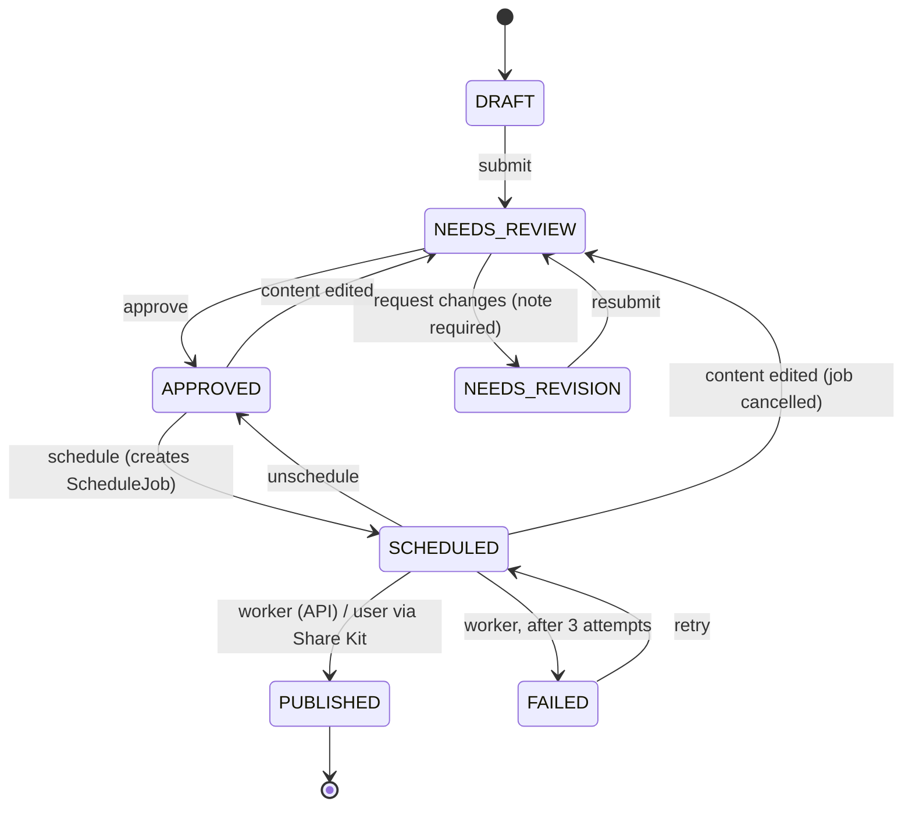
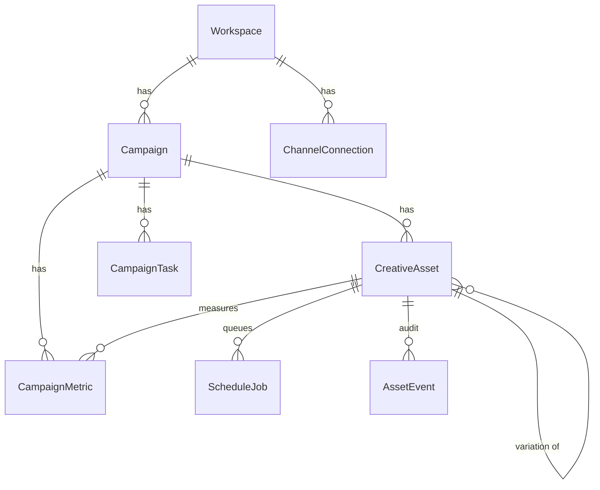

# LaunchLoop: system and data model overview

LaunchLoop does four things. It turns facts you give it about a product into multi-format creatives. It makes a person approve each creative. It publishes approved creatives on a schedule. It runs the launch checklist around all of that. It never scrapes social platforms and never automates a UI to get around a platform's rules.

```mermaid
flowchart LR
  subgraph Sources["Authorized sources"]
    URL["Website URL<br/>(robots.txt + sitemap)"]
    Paste["Manual paste"]
    Kit["Brand kit<br/>logo · colours · screenshots"]
    Hook1["POST /webhooks/product-update"]
  end
  Sources --> WS[(Workspace<br/>facts · brand · locale)]
  WS --> AI["AIService<br/>Gemini · OpenAI · Mock"]
  AI --> CA[(CreativeAsset<br/>DRAFT)]
  CA --> Q{{"Approval queue<br/>human review"}}
  Q -->|approve + schedule| SJ[(ScheduleJob)]
  SJ --> W["Scheduler worker"]
  W -->|API channel + auto rule on| API["Official APIs<br/>(mock adapter by default)"]
  W -->|Share Kit channel| SK["Share Kit task<br/>media · caption · UTM · checklist"]
  API --> PUB["PUBLISHED"]
  SK -->|user marks published| PUB
  PUB --> T[(CampaignTask<br/>48h review)]
  PUB --> M[(CampaignMetric)]
  Hook2["POST /webhooks/conversion<br/>utm_content → asset"] --> M
  M --> IT["Iterate on top performer"] --> CA
```

## 1. Ingestion (authorized sources only)

| Source | How it is used | Guardrails |
|---|---|---|
| Website URL | Fetches the page plus up to 3 same-origin pages from its sitemap that look like feature, pricing or about pages. | Honours `robots.txt` for the `LaunchLoopBot` user agent. Blocks private and internal addresses (SSRF guard). 8 s timeout, 1.5 MB cap. Never sends credentials. |
| Manual paste | Same analysis on text you paste. | Used whenever a site disallows us or can't be reached. |
| Brand kit | Logo, three brand colours, fonts and up to 4 screenshots, stored on the workspace. | Images only, with size limits. |
| Product-update webhook | Your app announces a release. LaunchLoop creates a campaign and generates DRAFT creatives in the background. | HMAC-signed, idempotent. Drafts are never auto-approved. |

`AIService.analyzeProduct` returns structured JSON (name, tagline, features with benefits, value props, pain points, audience, pricing, hooks and referral mechanics), which you can edit on the **Product source** page. Every later generation reads only these facts. The model is told never to invent statistics, testimonials or user counts.

## 2. Approval gating (state machine)

The invariant is that **content that goes out is exactly the content a person approved.** Four rules enforce it:

- The only way into `SCHEDULED` is from `APPROVED`, or from a `FAILED` retry, which was itself scheduled from `APPROVED`.
- Any edit to an `APPROVED`, `SCHEDULED` or `FAILED` item moves it back to `NEEDS_REVIEW` and cancels its pending job.
- Only the `worker` actor (auto-publish) or `share_kit` (a person confirming a manual post) can move an item to `PUBLISHED`. Only the worker can set `FAILED`.
- The worker checks `state === 'SCHEDULED'` again when the job runs and claims the job atomically, so a race can't publish something that was pulled back.
- Regenerating a package only replaces `DRAFT` and `NEEDS_REVISION` items. Regenerating a locked item creates a new draft variant (`parent_id`) and leaves the original alone.

Every transition writes an `asset_events` row (from, to, actor, note), which is the audit trail shown in each creative's History.

## 3. Scheduled publishing

`ScheduleJob` statuses: `pending`, then `running`, then one of `done`, `retry`, `failed`, `manual_required` or `cancelled`.

When a job comes due, the worker:

1. Claims the job with `UPDATE … WHERE status IN ('pending','retry')`. Only one worker wins.
2. Skips the job (`cancelled`) if the asset is no longer `SCHEDULED`.
3. Auto-publishes only if **all** of these are true: the item's `auto_publish` is on, the channel connection is in `api` mode, and the channel's auto-publish rule is on. Otherwise it sets `manual_required` and creates a Publishing task that links to the item's Share Kit.
4. On success, sets `PUBLISHED` and creates a "Review performance & iterate" task due 48 h later. In mock mode it also starts metrics labelled *simulated*.
5. On error, retries after 30 s and then 2 min. After the 3rd attempt it sets `FAILED` and creates a "Fix failed post" task.

The MVP runs `tick()` in-process every `WORKER_INTERVAL_MS`. `POST /api/worker/tick` runs the same function, so you can drive it from cron, Vercel Cron or a queue worker in production.

## 4. Campaign timeline and tasks

Creating a campaign generates a checklist relative to the launch date (L-10 … L+7) in five categories: **Setup, Creative Review, Publishing, Community/Viral Actions, Analytics Review**. Each task has a role, a due date and a done toggle. With an AI key the checklist is tailored to the product; without one a template is used. The system also adds tasks as things happen:

| Trigger | Task added |
|---|---|
| Share Kit item comes due | Publish via Share Kit: … |
| Publish fails 3 times | Fix failed post: … |
| Item published | Review performance & iterate (48 h) |
| Variation generated | Review follow-up variation |

Progress (`GET /api/campaigns/:id/progress`) reports:

- task completion %, done vs remaining, overdue and upcoming tasks, and per-category progress
- publish readiness: approved + scheduled + published as a share of all creatives
- per-channel readiness
- the next scheduled jobs and the publish log
- metric totals and conversions by channel
- the current iteration prompt

## 5. Growth features

- **Hook & Virality Advisor** (`scorer.js`) is a transparent heuristic that works offline. It scores four things: hook clarity (≤12 words, speaks to the viewer, names a pain, specific), show-don't-tell (screen-recording or before/after scenes, step slides, real screenshots), shareability (a share, save, comment or referral mechanic) and CTA + tracked link. Every score comes with its reasons, concrete suggestions and four share mechanics adapted to the product.
- **UTM builder.** Every creative gets `utm_source=<channel>`, `utm_medium=social|social_video`, `utm_campaign=<campaign slug>` and `utm_content=<format>-<assetId>-v<version>`. Existing `utm_*` parameters are replaced, and other query parameters and the hash are kept.
- **Attribution.** `POST /api/webhooks/conversion` reads `utm_content` (or a `landing_url`) and maps the signup back to the exact creative and channel.
- **Post-publish loop.** The top performer, scored as signups×10 + clicks + shares×3, appears on the dashboard and analytics page. "Generate variation" keeps the winning format and channel and tests a different hook angle. The new item is a DRAFT, so it goes through approval again.

## 6. Data model

| Entity | Key fields |
|---|---|
| `Workspace` | name, website_url, tagline, description, features[{name, benefit}], value_props[], pain_points[], audience, pricing, offer, referral_mechanics, brand{colors, fonts, logo}, locale{language, region, currency, dateFormat, tone}, screenshots[], source_meta, webhook_secret |
| `Campaign` | workspace_id, name, goal, base_url, utm_campaign, channels[], launch_date, status, source (`manual` or `webhook:*`) |
| `CreativeAsset` | campaign_id, channel, format (`reel`, `video`, `flyer`, `post`, `carousel`), aspect_ratio, title, headline, caption (with `{{link}}`), cta, hashtags[], content (script, storyboard, slides, value props…), state, score, version, parent_id, scheduled_at, auto_publish, published_at, external_url, error, review_note, generator, utm_url |
| `ScheduleJob` | asset_id, channel, run_at, status, attempts, last_error, log[{at, level, msg}] |
| `CampaignTask` | campaign_id, title, description, category, role, due_date, done, done_at, source (`auto`, `manual`, `scheduler`, `post_publish`), asset_id |
| `ChannelConnection` | workspace_id, channel, mode (`api` or `share_kit`), status (`connected`, `mock`, `disconnected`), auto_publish, token_ref |
| `CampaignMetric` | campaign_id, asset_id, channel, date, impressions, clicks, shares, signups, source (`simulated`, `manual`, `webhook`, `api`) |
| `AssetEvent` | asset_id, from_state, to_state, actor, note, at |
| `WebhookEvent` | `<workspace>:<event-id>` (idempotency key), type, payload, result |

The schema is plain SQL in `src/db.js` with `CHECK` constraints on every enum. It ports directly to Postgres.

## 7. AI provider layer

`AIService` chooses `gemini` or `openai` from the environment (`AI_PROVIDER=auto` uses whichever key it finds first) and falls back to `mock`. Every method returns the same normalised shape. Model output is merged over the mock skeleton (`normalizeAsset`), so missing fields can't break the UI. Network, quota and JSON errors degrade to mock output, and the reason is recorded in `generator`, for example `mock (fallback: openai 429)`.

| Capability | Gemini | OpenAI | Mock |
|---|---|---|---|
| Product analysis → JSON | `generateContent` with JSON response type | Chat Completions with `json_object` response format | heuristic extraction |
| Copy, scripts, storyboards, tasks | ✓ | ✓ | deterministic templates |
| Flyer background art | – | Images API (`AI_IMAGE_GENERATION=true`) | brand SVG only |
| Video | structured render job | structured render job | structured render job + animated SVG preview |

Flyers, post images and carousel slides are always rendered as brand-aware SVG on the server, so text stays sharp and editable. The browser exports them to PNG. Videos ship as a renderer-agnostic **render job** (scenes with timings, footage hints, voiceover, captions, music and brand). A renderer such as Remotion, an FFmpeg pipeline or a render API turns that into an MP4.

## 8. Going live (what you need)

| Channel | Credential env vars | Notes |
|---|---|---|
| X | `X_USER_ACCESS_TOKEN` | Text post adapter included. Media upload is an extension point. Needs an X API tier that allows posting. |
| LinkedIn | `LINKEDIN_ACCESS_TOKEN`, `LINKEDIN_AUTHOR_URN`, `LINKEDIN_API_VERSION` | Text post adapter included. Company pages need Community Management API approval. |
| Instagram / Facebook / Threads | `META_ACCESS_TOKEN`, `INSTAGRAM_USER_ID`, `FACEBOOK_PAGE_ID`, `THREADS_USER_ID` | Need Meta app review. Media must be on a public URL (`PUBLIC_BASE_URL`), and video needs a rendered MP4. Falls back to Share Kit until you add an adapter. |
| YouTube Shorts | `YOUTUBE_OAUTH_TOKEN` | `videos.insert` needs an MP4. Unverified apps upload as private. |
| TikTok | `TIKTOK_ACCESS_TOKEN` | Without TikTok's audit, posts are private only, so the channel defaults to Share Kit. |
| Reddit, Product Hunt | – | Share Kit by design (subreddit rules; no public launch API). |

With `PUBLISH_MODE=live`, a channel without credentials or without a live adapter becomes `manual_required` and goes to the Share Kit. It never fails silently and never falls back to automating a UI. The live adapters were written against the public API docs but haven't been tested against the real platforms, so check them in a sandbox account first.

## 9. Security notes

- Webhooks require `X-LaunchLoop-Signature: t=<unix>,v1=<HMAC-SHA256(secret, "<t>.<raw body>")>` with a 5-minute window and a constant-time comparison. Sending `X-LaunchLoop-Event-Id` makes a request idempotent.
- `APP_API_TOKEN` (optional) puts the dashboard API behind a bearer token. This is single-user auth for the MVP. Add real user accounts and roles before multi-tenant use.
- The URL importer blocks private, loopback and link-local addresses. For production, also pin the resolved IP between the check and the fetch to defend against DNS rebinding.
- OAuth tokens should live in a secrets manager or an encrypted column. `token_ref` is where that reference goes.

## 10. Path to production

- **Next.js port.** `src/services/*` is framework-free. Route handlers map 1:1 to Next.js `app/api/**/route.ts`, and the views map to React pages.
- **Postgres + queue.** Swap `src/db.js` for Postgres. Run `tick()` from a queue (BullMQ, SQS) or claim jobs with `SELECT … FOR UPDATE SKIP LOCKED`.
- **Media rendering.** Upload SVG, PNG and MP4 renders to object storage so platform APIs can fetch them from a public URL.
- **Insights.** Replace simulated metrics with each platform's insights API, written as `source='api'`.
